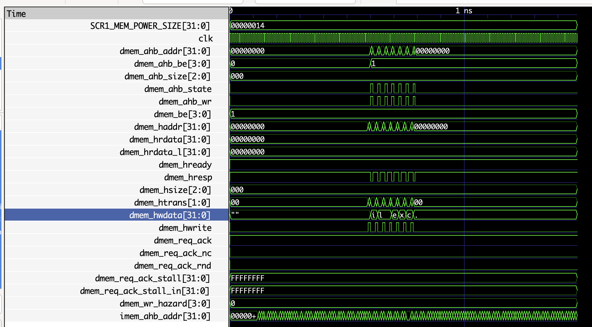

# Лабораторная работа 2. SCR1: вектора сброса и прерываний

Вариант 3.

| Параметр | Значение |
|---|---|
| Исключение | Illegal instruction |
| Тест | `isa/rv32mi/illegal.S` |
| Reset Vector | `0x2000` |
| Trap Vector | `0x1880` |
| Обработчик | вывод строки «illexc» |

## Запуск
```sh
git submodule update --init --recursive
```

```sh
make clean
make run_verilator TARGETS="riscv_isa"
```

Ожидаемый вывод:

```
---Test:                      illegal.hex
illexc
Test passed

#--------------------------------------
# Summary: 1/1 tests passed
#--------------------------------------
...
                          Test               | build | simulation
                     illegal.hex		OK	  PASS
```

### Запуск с временными диаграммами

```sh
make clean
make run_verilator_wf TARGETS="riscv_isa" TRACE=1
gtkwave build/verilator_wf_AHB_MAX_imc_IPIC_1_TCM_1_VIRQ_1_TRACE_1/simx.vcd
```


